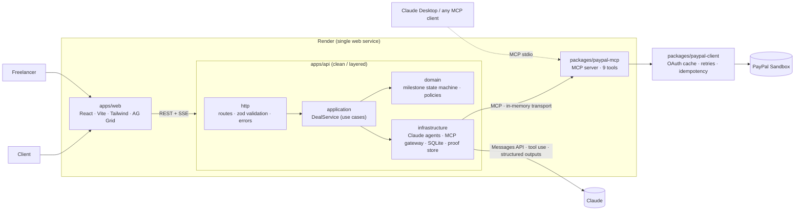

<div align="center">

# Arko Pay-on-Proof

**AI escrow agents for freelance work, backed by PayPal.**
The client's money is *held* by PayPal, the work is *checked* by AI, and the money *moves* only when a person approves.

PayPal AI Hackathon 2026 · PayPal Orders, Payments, Invoicing · Claude agents · MCP · AG Grid · Render

</div>

---

## The problem

Every freelance deal starts with a standoff:

- **Freelancers** fear delivering and never getting paid.
- **Clients** fear paying upfront for work that is late, wrong or never arrives.
- **When they disagree**, nobody neutral decides. It becomes weeks of email, chargebacks or a write-off.

Marketplace escrow only works *inside* a marketplace, takes a large fee and relies on human reviewers. But most freelance work is agreed **directly**, over WhatsApp, email or a call, with **no protection at all**.

## The solution

Arko turns any agreement into PayPal-backed milestones and puts three AI agents between the two parties:

| | Agent | What it does |
|---|---|---|
| 📝 | **Contract Agent** | Reads a **statement of work or work order in any format**: PDF (including tables and scans), Word, image, email, HTML or text. It mirrors the document's phases and payment schedule as **milestones**, with deliverables, due dates and an **objective definition of done**. This AI split is **v1** and needs approval from both parties. |
| 🧐 | **Plan Reviewer** | Before funding, checks the split for definition-of-done items that can't be tested, missing formats, totals that don't match the document, and dates that are unrealistic or out of order. |
| 🔍 | **Verifier Agent** | Looks at the proof (images, PDFs, text files, links, notes) and scores **each criterion** as met, partly met or not met, with evidence. |
| ⚖️ | **Mediator Agent** | When the two sides disagree, it reads both statements and the evidence and proposes a **fair split**, for example 80/20. |
| 💬 | **Arko (chat)** | Answers "where's my money?", checks PayPal **live through MCP**, runs verification and **prepares** releases, which always wait for a human approval card. |

### The whole lifecycle, orchestrated

```
 PLAN ─────────────► AGREE ─────────► FUND ─────────► DELIVER ─────────► VERIFY ─────────► SETTLE
 Contract Agent      both parties      PayPal hold      proof upload        Verifier Agent     capture / split / void
 drafts milestones   accept the SAME   per milestone    due dates,          (or dispute →      + receipt invoice
 Plan Reviewer (AI)  plan version      (AUTHORIZE)      extension requests  Mediator Agent)    human-approved
 versioned edits                                        hold renewal
```

- **Milestone planning:** split the deal into milestones, each with an amount, due date, dependency ("starts after M1"), a **specification**, **deliverables with formats** and a **definition of done** (objective acceptance criteria).
- **Payment terms:** funding schedule, client review window, included revision rounds, maximum extension per request, late-delivery and cancellation policies.
- **Negotiation with versions:** either party edits the plan, and every save becomes **v2, v3, …** with a change log. Saving clears the other party's acceptance, and stale edits are rejected (optimistic concurrency). Money can be held only after **both parties accept the same version**.
- **AI plan review:** before funding, the Plan Reviewer flags definition-of-done items that can't be tested, deliverables without formats, totals that don't match the agreement, and unrealistic dates.
- **Extensions:** after the plan is agreed, due dates move only through **extension requests**. One party asks with a reason, the other approves or declines, and requests are capped by the agreed maximum. If an extension pushes the deadline past the PayPal hold's expiry, the client is asked to **renew the hold** (PayPal reauthorize).
- **Schedule signals:** overdue delivery, client review past the agreed window, and holds about to expire are shown on every milestone, in the workflow map and to the Arko chat agent.
- **Orchestration graph (Step Functions–style):** a pan-and-zoom state machine for every deal: *Start → Read SOW (AI) → AI milestone split → Plan review → Negotiate → **Parallel** approvals (client ∥ freelancer) → Plan locked → **Map** over milestones*. Each branch runs *PayPal hold → Wait for delivery → Verifier → **Choice** (passed?)*, then either *client approval → capture* or *Mediator → both accept → partial capture*, then *Succeed*. The path that ran is green, running steps pulse with animated edges, branches not taken fade out, and clicking any step opens a details drawer.
- **Workflow lanes:** an alternative view with three layers (**human decisions**, **AI agents**, **PayPal rails**), one lane per milestone, a "your next steps / waiting on them" queue, and a schedule timeline showing original and extended dates.
- **Access per party:** each party gets an HMAC-signed **invite link**. The server works out *who* is acting from that key, so a freelancer can't approve the client's release. Without a key you can't see the deal.

### How the money moves (PayPal Sandbox)

```
Client approves → Orders v2 (intent AUTHORIZE) → funds HELD on the client's PayPal account
                                     │
          proof verified + client approves ──► capture (full)        → freelancer paid  + receipt invoice
          dispute → agreed split ────────────► capture (partial, final_capture=true) → rest auto-returned
          cancelled ─────────────────────────► void authorization    → client keeps everything
          after release ─────────────────────► refund capture        → full / partial refund
```

### What makes it safe

- **AI never moves money.** Agents and the chat can only *propose*. Every release, split, cancellation or refund becomes a **Pending Action** with policy checks, and only the right person can approve it. Releasing or splitting needs the client. Cancelling after delivery, or refunding, needs the freelancer.
- **Policy gate** (strategy pattern): funds are held, the amount is within the hold, a per-action limit applies, the work is verified (an *agent* can never release unverified work), and a split needs both parties to accept. The checks run again at approval time.
- **Idempotent PayPal writes:** every write sends a deterministic `PayPal-Request-Id`, so a retry can't capture twice.
- **Prompt-injection aware:** agreement text, proofs and statements are wrapped as untrusted evidence, and the agents are told to ignore instructions inside them.
- **Full audit trail** of every agent decision, approval and PayPal response ID.

---

## Architecture



- **Every PayPal call goes through the MCP server**, even inside our own API, which talks to it as an MCP client. The same audited tool surface is available to any external agent.
- The **milestone state machine** (`apps/api/src/domain/milestone.ts`) rejects illegal moves, such as releasing before funding or cancelling after payment.
- See [docs/DESIGN.md](docs/DESIGN.md) for the full design, the patterns used and how the project maps to the judging criteria.

### Repository layout

```
arko-pay/
├─ apps/
│  ├─ api/                     Express + TypeScript (layered: http → application → domain; infrastructure behind ports)
│  │  ├─ src/domain/           state machine, policies, errors (pure — no I/O)
│  │  ├─ src/application/      DealService use cases + ports (interfaces)
│  │  ├─ src/infrastructure/   claude/ (agents, chat), mcp/ (PayPal gateway), persistence/ (node:sqlite), storage/
│  │  ├─ src/http/             routes, validation, error middleware, SSE chat
│  │  └─ src/config/           env (zod) + composition root
│  └─ web/                     React 19 + Vite + Tailwind v4 + AG Grid (feature-sliced)
├─ packages/
│  ├─ paypal-client/           typed PayPal REST client — no dependencies
│  ├─ paypal-mcp/              MCP server (stdio entry + in-process factory)
│  └─ shared/                  zod schemas + DTOs shared by web and api
└─ docs/DESIGN.md
```

### PayPal APIs used

| Capability | Endpoint | MCP tool |
|---|---|---|
| OAuth2 (cached) | `POST /v1/oauth2/token` | — |
| Hold funds | `POST /v2/checkout/orders` (`intent: AUTHORIZE`) | `paypal_create_hold` |
| Place hold after approval | `POST /v2/checkout/orders/{id}/authorize` | `paypal_authorize_order` |
| Order status | `GET /v2/checkout/orders/{id}` | `paypal_get_order` |
| Hold status / expiry | `GET /v2/payments/authorizations/{id}` | `paypal_get_authorization` |
| Renew hold (after extension) | `POST /v2/payments/authorizations/{id}/reauthorize` | `paypal_reauthorize` |
| Release / split | `POST /v2/payments/authorizations/{id}/capture` | `paypal_capture_authorization` |
| Cancel | `POST /v2/payments/authorizations/{id}/void` | `paypal_void_authorization` |
| Refund | `POST /v2/payments/captures/{id}/refund` | `paypal_refund_capture` |
| Pay collaborators | `POST /v1/payments/payouts` | `paypal_create_payout` |
| Receipt for the books | `POST /v2/invoicing/invoices` (+ `send`, `payments`) | `paypal_create_receipt_invoice` |

### AI used

- **Claude** (`claude-opus-5-5` by default, configurable with `ARKO_MODEL`) through the official Anthropic TypeScript SDK.
  - Contract, Verifier and Mediator use **structured outputs** (zod schemas) and adaptive thinking. The Verifier and Mediator read **images and PDFs** directly.
  - The chat agent is a **streaming tool-use loop** (SSE to the browser) with input validation on every tool call.
  - Server-side **refusal fallbacks** (`fallbacks: "default"`) are enabled, so a declined request is retried on a fallback model.
- **MCP** (`@modelcontextprotocol/sdk`): a custom PayPal MCP server with `readOnlyHint` and `destructiveHint` annotations.

### Sponsor tools

- **Render:** `render.yaml` Blueprint for a one-click hosted demo.
- **AG Grid:** the escrow ledger (every milestone with its PayPal order, authorization, capture and invoice IDs).

---

## Run it locally (about 5 minutes)

**Requires** Node.js **22.13+** (it uses the built-in `node:sqlite`), a free PayPal Developer account and an Anthropic API key.

### 1. Get PayPal Sandbox credentials
1. Sign in at <https://developer.paypal.com> → **Apps & Credentials** → make sure the **Sandbox** toggle is on.
2. Click **Create App** (type *Merchant*), then copy the **Client ID** and **Secret**.
3. Under **Testing Tools → Sandbox Accounts**, note the default **Personal** account's email and password. You will sign in with it as the *client* when you approve a hold.

### 2. Configure and start
```bash
git clone <this repo> arko-pay && cd arko-pay
cp .env.example .env        # fill PAYPAL_CLIENT_ID, PAYPAL_CLIENT_SECRET, ANTHROPIC_API_KEY
npm install
npm run dev                 # API on :8787, web on http://localhost:5173
```

### 3. Try the full flow
1. On **New deal**, drag in a statement of work: try [`docs/samples/sample-sow.md`](docs/samples/sample-sow.md) or any PDF, Word document or photo of a work order. Then click **Split into milestones with AI**. Its 30/40/30 payment schedule becomes three milestones, each with deliverables and a definition of done. You land on **Plan & terms**.
2. Click **Review this plan** (AI). Adjust amounts, dates, deliverables or the definition of done, then **Save as v2**.
3. As the **Client**, accept plan v2. Switch the role toggle (top right) to **Freelancer** and accept the same version. In real use, send the freelancer their link from **Invite**.
3. As the client, click **Hold $350.00 with PayPal**. Sign in with the sandbox *Personal* account and approve. The milestone changes to **Held by PayPal**.
4. As the freelancer, upload proof, for example a PNG of a logo plus a note. Then click **Verify with AI**.
5. As the client, click **Release**. The approval card shows the policy checks. Click **Approve & pay**: PayPal captures and a receipt invoice is created.
6. On milestone 2, raise a **dispute** from both sides, click **Ask the Mediator**, accept the split as both parties, and **execute the split**. You'll see a partial capture, with the rest returned automatically.
7. Open **Ask Arko**: *"What's held in escrow right now?"* or *"Release milestone 1 if it passed"*.
8. Open the **Escrow ledger** (AG Grid) and the **Audit trail**.

### Tests and checks
```bash
npm test          # vitest: PayPal client, MCP server, state machine, policies, negotiation, extensions, access keys
npm run typecheck # strict TypeScript across all workspaces
```

---

## Use the PayPal MCP server from Claude Desktop

The same escrow tools can be used by any MCP client. Add this to `claude_desktop_config.json`:

```json
{
  "mcpServers": {
    "arko-paypal": {
      "command": "/ABSOLUTE/PATH/arko-pay/node_modules/.bin/tsx",
      "args": ["/ABSOLUTE/PATH/arko-pay/packages/paypal-mcp/src/stdio.ts"],
      "env": { "PAYPAL_CLIENT_ID": "…", "PAYPAL_CLIENT_SECRET": "…", "PAYPAL_ENV": "sandbox" }
    }
  }
}
```

Then ask Claude *"check the status of PayPal authorization 0VF5…"*. Tools marked destructive (capture, void, refund, payout) trigger Claude Desktop's own approval prompt.

## Deploy on Render

1. Push this repo to GitHub, then in Render choose **New → Blueprint** and select the repo. Render reads `render.yaml`.
2. Enter `PAYPAL_CLIENT_ID`, `PAYPAL_CLIENT_SECRET`, `ANTHROPIC_API_KEY`, and set `PUBLIC_URL` to the service URL (for example `https://arko-pay.onrender.com`).
3. The API serves the built web app from the same origin, so PayPal's return URL works without any CORS setup.

> The free plan's disk is temporary: deals reset when the service redeploys. That's fine for a demo. Attach a Render Disk and set `DATA_DIR` to keep data.

## Environment variables

| Variable | Required | Default | Notes |
|---|---|---|---|
| `PAYPAL_CLIENT_ID` / `PAYPAL_CLIENT_SECRET` | ✓ | — | Sandbox app credentials |
| `PAYPAL_ENV` | | `sandbox` | `live` only with real credentials |
| `ANTHROPIC_API_KEY` | ✓ | — | |
| `ARKO_MODEL` | | `claude-opus-5-5` | Any Claude model ID |
| `PUBLIC_URL` | | `http://localhost:5173` | Where PayPal sends the payer back |
| `MAX_ACTION_AMOUNT` | | `5000` | Policy limit for any single money movement |
| `API_PORT` | | `8787` | Development only; production uses `PORT` |
| `DATA_DIR` | | `./data` | SQLite database and uploaded proofs |
| `APP_SECRET` | prod | auto (dev) | 32+ chars; signs the per-party invite keys |

## Limitations and roadmap

- Access uses **signed per-party invite links** (capability keys). Full accounts with SSO and KYC come next.
- **Sandbox only.** PayPal authorizations stay valid for 29 days (3-day honor period). Reauthorizing long holds is on the roadmap.
- Planned: auto-release after a review window, webhooks instead of polling, payee onboarding with PayPal Commerce Platform (so each freelancer receives funds directly), and multi-currency payouts to sub-contractors from the UI.

## License

[MIT](LICENSE)
