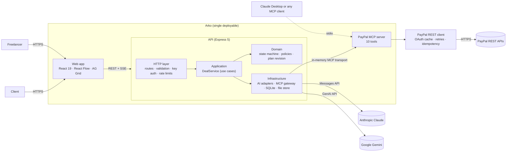
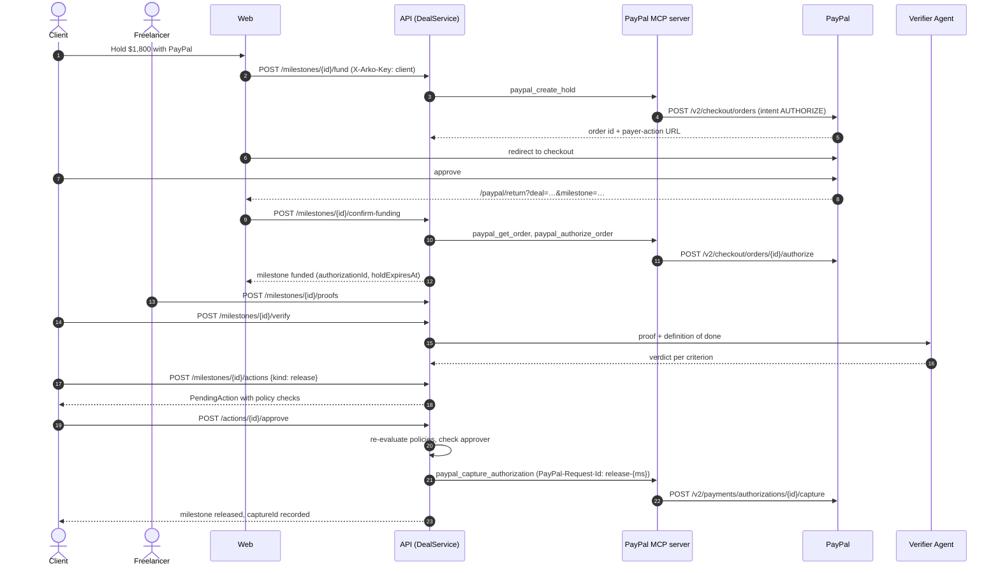
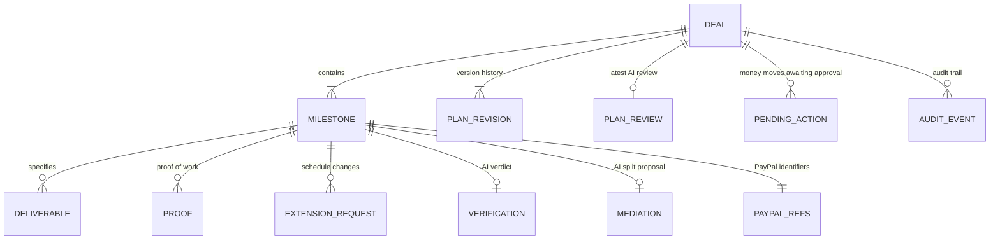
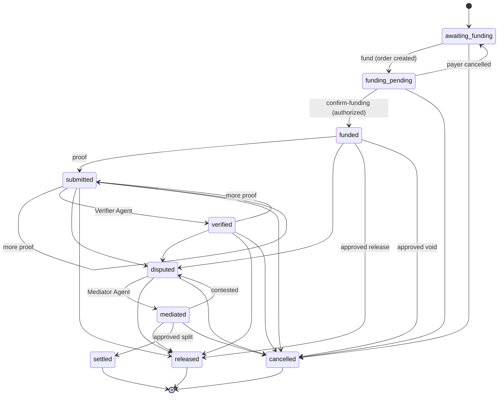

# Arko Pay-on-Proof

Milestone escrow for freelance work, built on PayPal authorizations, with AI agents that read the contract and check the work, and a person approving every payment.

| | |
|---|---|
| **Status** | Hackathon build (PayPal AI Hackathon 2026). Runs end to end against the PayPal **sandbox**. |
| **Stack** | TypeScript, Node.js 22, Express 5, React 19, SQLite (`node:sqlite`), Model Context Protocol |
| **Payments** | PayPal Orders v2, Payments v2, Invoicing v2, Payouts v1 |
| **AI** | Anthropic Claude or Google Gemini, behind one interface |
| **License** | MIT |

---

## Contents

1. [Why this exists](#1-why-this-exists)
2. [How it works](#2-how-it-works)
3. [Architecture](#3-architecture)
4. [Design decisions](#4-design-decisions)
5. [Domain model and data schema](#5-domain-model-and-data-schema)
6. [Milestone state machine](#6-milestone-state-machine)
7. [Payment policies and approvals](#7-payment-policies-and-approvals)
8. [REST API contract](#8-rest-api-contract)
9. [PayPal MCP server contract](#9-paypal-mcp-server-contract)
10. [PayPal integration](#10-paypal-integration)
11. [AI agents](#11-ai-agents)
12. [Security model](#12-security-model)
13. [Getting started](#13-getting-started)
14. [Configuration reference](#14-configuration-reference)
15. [Testing](#15-testing)
16. [Deployment](#16-deployment)
17. [Operations](#17-operations)
18. [Repository layout](#18-repository-layout)
19. [Known limitations and roadmap](#19-known-limitations-and-roadmap)

---

## 1. Why this exists

Most freelance work isn't bought through a marketplace. It's agreed on a statement of work, an email thread or a call, and then both sides take a risk. The freelancer delivers and hopes the invoice gets paid. The client pays a deposit and hopes the work turns up. When they disagree about whether a phase is "done", there is no neutral party, so the dispute goes to email, a card chargeback, or nowhere.

Marketplace escrow handles this, but only for work done on that platform, and the fees and review times reflect that. Arko applies the same idea to direct deals:

- the agreement is turned into **milestones with an objective definition of done**,
- the client's money for each milestone is **held by PayPal** (authorized, not captured),
- **AI agents** do the reading and checking (contract parsing, plan review, proof verification, dispute mediation),
- **a person approves every money movement**, after policy checks that the system re-runs at the moment of approval.

## 2. How it works

| Stage | What happens | Actor |
|---|---|---|
| **Ingest** | The client or freelancer uploads the SOW (PDF, DOCX, image, HTML, RTF, EML, text) or pastes it. | Person |
| **Plan** | The Contract Agent proposes milestones following the document's own payment schedule, each with deliverables, a due date, dependencies and a definition of done. This proposal is plan **v1**. | AI |
| **Review** | Optional. The Plan Reviewer scores readiness and flags untestable criteria, totals that don't reconcile, and date problems. | AI |
| **Negotiate** | Either party edits the plan. Each save creates a new version with a change log and clears the other party's acceptance. | People |
| **Agree** | Both parties accept the **same version**. The plan locks and the deal becomes `active`. | People |
| **Fund** | The client funds a milestone. Arko creates a PayPal order with `intent: AUTHORIZE`, and the client approves in PayPal checkout. Arko then authorizes the order. | Person, PayPal |
| **Deliver** | The freelancer uploads proof (files, links, notes). Due dates move only through extension requests approved by the other party. | Person |
| **Verify** | The Verifier Agent scores every definition-of-done item against the proof, with evidence. | AI |
| **Settle** | **Release:** full capture. **Dispute:** the Mediator Agent proposes a split, both accept, and Arko does a partial capture with `final_capture=true`. **Cancel:** void. Every one of these needs a human approval. | People, PayPal |

Settlement arithmetic for a dispute, where $A$ is the held amount and $p$ the accepted freelancer share:

$$
\text{capture} = \operatorname{round}_{\text{cents}}(A \cdot p), \qquad \text{returned to client} = A - \text{capture}
$$

The split is computed in integer cents, so the two parts always add up to $A$.

## 3. Architecture

### 3.1 System context



The API and the web app ship as one service. In production the API serves the built SPA from the same origin, so the PayPal return URL needs no CORS configuration.

### 3.2 Layering

The API follows a ports-and-adapters layout. Dependencies only point inward.

| Layer | Path | Responsibility | Depends on |
|---|---|---|---|
| Domain | `apps/api/src/domain` | Milestone state machine, payment policies, plan revision and diff, extension rules, typed errors. Pure functions, no I/O. | `@arko/shared` |
| Application | `apps/api/src/application` | `DealService` (one method per use case), ports (interfaces), access keys | Domain |
| Infrastructure | `apps/api/src/infrastructure` | Claude and Gemini adapters, MCP payments gateway, SQLite repositories, file proof store, SOW reader | Application ports |
| HTTP | `apps/api/src/http` | Routes, zod validation, key authentication, error mapping, rate limiting, SSE | Application |
| Composition root | `apps/api/src/config/container.ts` | Wires concrete adapters to ports, chooses the AI provider | Everything |

### 3.3 Funding and release sequence



## 4. Design decisions

**PayPal authorizations are the escrow primitive.** Rather than collecting the money and paying it out later, each milestone is an authorization on the client's account. That gives the semantics escrow needs, using operations PayPal already supports: hold (authorize), release (capture), split (partial capture with `final_capture=true`, which voids the remainder), cancel (void), and extend (reauthorize). Arko never holds funds itself.

**All money movement goes through one MCP server.** The API doesn't call PayPal directly. It is an MCP client of the Arko PayPal MCP server, the same server an external agent such as Claude Desktop would use. There is one audited surface, and every tool is annotated as `readOnlyHint` or `destructiveHint`.

**Agents propose, people approve.** No AI component can execute a capture, void, refund or payout. The chat agent's only money-related tool creates a `PendingAction`. Execution happens in `DealService.approveAction`, which runs only for the authorized party, after policies are re-evaluated against current state.

**The plan is versioned and signed by version.** Acceptance is recorded against a version number. Any edit increments the version and resets acceptance to the editor. A stale `expectedVersion` returns `409 VERSION_CONFLICT`. Nobody can be held to terms they didn't see.

**The acting party comes from a signed key, never from the request body.** Each party holds an HMAC-signed capability key for the deal. The server derives "who is acting" from that key.

**The AI provider is a deployment choice.** Agents depend on a `StructuredLlm` port. Claude and Gemini adapters implement it, and the composition root picks one from configuration.

**Aggregates are stored as documents.** A deal and its milestones change together and are always read together, so they're stored as one JSON document per deal in SQLite, with indexed columns only where we filter. This keeps the write path atomic without an ORM.

## 5. Domain model and data schema

The canonical definitions are zod schemas in [`packages/shared/src/schemas.ts`](packages/shared/src/schemas.ts). The API and the web app both use them, so the contract can't drift. Conventions:

- Money is a **decimal string** with up to two places (`"1800.00"`), matching PayPal's wire format. Arithmetic is done in integer cents.
- Timestamps are ISO-8601 UTC strings. Calendar dates (due dates, hold expiry) are `YYYY-MM-DD`.
- IDs are prefixed and URL-safe: `deal_…`, `ms_…`, `act_…`, `proof_…`, `ext_…`, `dlv_…`, `evt_…`.

### 5.1 Entity overview



### 5.2 Deal

| Field | Type | Notes |
|---|---|---|
| `id` | string | `deal_…` |
| `title`, `summary` | string | |
| `clientName`, `freelancerName`, `freelancerEmail` | string | |
| `currency` | `USD \| EUR \| GBP \| AUD \| CAD` | One currency per deal |
| `sourceText` | string | Pasted agreement, or the Contract Agent's faithful transcription of an uploaded document |
| `sourceDocument` | `{ name, mimeType } \| null` | Metadata of the uploaded SOW |
| `status` | `proposed \| active \| completed` | Derived. See 6.2 |
| `version` | int | Plan version, starts at 1 |
| `acceptedBy` | `Party[]` | Parties that accepted the **current** version |
| `terms` | `PaymentTerms` | |
| `revisions` | `PlanRevision[]` | Append-only history |
| `planReview` | `PlanReview \| null` | Latest AI review, tagged with the version it reviewed |
| `createdAt` | ISO timestamp | |
| `milestones` | `Milestone[]` | Ordered by `position` |

### 5.3 Milestone

| Field | Type | Notes |
|---|---|---|
| `id`, `dealId`, `position` | string, string, int | |
| `title`, `description` | string | `description` is the specification |
| `amount` | decimal string | Amount held for this milestone |
| `criteria` | `string[]` | **Definition of done**: objective acceptance criteria |
| `deliverables` | `Deliverable[]` | `{ id, name, format, notes }` |
| `dueDate`, `originalDueDate` | date or null | `originalDueDate` keeps the agreed date after extensions |
| `dependsOn` | milestone id or null | Must reference an earlier milestone |
| `extensions` | `ExtensionRequest[]` | Full history |
| `submittedAt` | ISO timestamp or null | First proof submission; starts the review window |
| `status` | `MilestoneStatus` | See section 6 |
| `paypal` | `PayPalRefs` | `orderId, approveUrl, authorizationId, captureId, refundId, invoiceId, payoutBatchId, payerEmail, authorizedAt, holdExpiresAt` |
| `capturedAmount` | decimal string or null | Amount actually paid to the freelancer |
| `proofs` | `Proof[]` | `{ id, kind: file\|link\|note, name, mimeType?, url?, note?, createdAt }` |
| `verification` | `Verification \| null` | See 11.3 |
| `mediation` | `Mediation \| null` | See 11.4 |
| `disputeStatements` | `Record<Party, string>` | One statement per party |
| `updatedAt` | ISO timestamp | |

### 5.4 Payment terms

| Field | Type | Default | Meaning |
|---|---|---|---|
| `fundingSchedule` | `per_milestone \| all_upfront` | `per_milestone` | When milestones are expected to be funded |
| `reviewWindowDays` | int 1–30 | 3 | Days the client has to review submitted work |
| `revisionRounds` | int 0–10 | 2 | Included revisions per milestone |
| `maxExtensionDays` | int 0–60 | 14 | Maximum days a single extension may add |
| `lateDeliveryPolicy` | string ≤ 500 | text | |
| `cancellationPolicy` | string ≤ 500 | text | |
| `notes` | string ≤ 1000 | `""` | Other terms (IP transfer, source files…) |

### 5.5 Supporting types

| Type | Shape |
|---|---|
| `PlanRevision` | `{ version, editedBy: client \| freelancer \| contract-agent, changes: string[], createdAt }` |
| `PlanReview` | `{ version, readiness: 0–100, summary, issues: PlanIssue[], reviewedAt }` |
| `PlanIssue` | `{ severity: blocker \| warning \| suggestion, milestone: string \| null, message, suggestion }` |
| `ExtensionRequest` | `{ id, requestedBy, fromDate, toDate, reason, status: pending \| approved \| rejected \| withdrawn, decidedBy, decisionNote, createdAt, decidedAt }` |
| `PendingAction` | `{ id, dealId, milestoneId, kind: release \| split \| cancel \| refund, summary, amount, currency, params: { approver, reason }, checks: PolicyCheck[], status: pending \| executed \| rejected \| failed, requestedBy: agent \| user, error, createdAt, decidedAt }` |
| `PolicyCheck` | `{ name, passed, detail }` |
| `AuditEvent` | `{ id, dealId, actor, type, message, data, createdAt }` |

### 5.6 Storage schema (SQLite)

```sql
CREATE TABLE deals (
  id          TEXT PRIMARY KEY,
  doc         TEXT NOT NULL,          -- Deal aggregate as JSON (milestones embedded)
  created_at  TEXT NOT NULL,
  updated_at  TEXT NOT NULL
);

CREATE TABLE actions (
  id          TEXT PRIMARY KEY,
  deal_id     TEXT NOT NULL,
  status      TEXT NOT NULL,          -- pending | executed | rejected | failed
  doc         TEXT NOT NULL,          -- PendingAction as JSON
  created_at  TEXT NOT NULL
);
CREATE INDEX actions_deal ON actions(deal_id, status);

CREATE TABLE audit (
  id          TEXT PRIMARY KEY,
  deal_id     TEXT,
  doc         TEXT NOT NULL,          -- AuditEvent as JSON
  created_at  TEXT NOT NULL
);
CREATE INDEX audit_deal ON audit(deal_id, created_at);
```

The database runs in WAL mode. Uploaded proof files are stored at `${DATA_DIR}/proofs/{proofId}`; proof ids are server-generated, so there's no path traversal surface.

## 6. Milestone state machine

### 6.1 Transitions



`transition()` in `domain/milestone.ts` enforces this table. An illegal move raises `INVALID_STATE` (HTTP 409). Funds are considered **held** in `funded`, `submitted`, `verified`, `disputed` and `mediated`.

### 6.2 Deal status

- `proposed` until both parties have accepted the current version.
- `active` once both have accepted.
- `completed` when every milestone is `released`, `settled` or `cancelled`.

### 6.3 Schedule signals

`milestoneHealth()` in `packages/shared/src/schedule.ts` is shared by the API, the UI and the chat agent, so they always agree:

| Signal | Rule |
|---|---|
| `overdue` / `daysLate` | Not yet delivered (`awaiting_funding`, `funding_pending`, `funded`) and today is after `dueDate` |
| `reviewDueAt` / `reviewOverdue` | `submittedAt + reviewWindowDays`, while `submitted` or `verified` |
| `holdExpiresInDays` | Days until `paypal.holdExpiresAt` |
| `holdNeedsRenewal` | `dueDate` is later than `holdExpiresAt` |
| `pendingExtension` | The open extension request, if any |

## 7. Payment policies and approvals

Every money movement is a `PendingAction`. Policies are evaluated when the action is proposed, so the approver sees them, and **again** at approval time against current state. If any check fails at approval, nothing is sent to PayPal and the action is marked `failed`.

| Policy | Applies to | Passes when |
|---|---|---|
| Funds are held by PayPal | release, split, cancel | An authorization exists and the milestone is in a held state |
| Payment was captured | refund | A capture exists |
| Within held amount / within captured amount | release, split, refund | `0 < amount ≤ milestone.amount` (or `≤ capturedAmount` for refunds) |
| Below per-action limit | all | `amount ≤ MAX_ACTION_AMOUNT` |
| Work verified | release | The Verifier recommended `release`, **or** the request came from a person. An agent can never release unverified work. |
| Both parties accepted the split | split | `mediation.acceptedBy` contains both parties |

**Required approver**

| Action | Approver |
|---|---|
| `release`, `split` | client |
| `cancel` | freelancer if proof has been submitted, otherwise client |
| `refund` | freelancer |

An approval from any other party returns `403 FORBIDDEN`.

## 8. REST API contract

Base path `/api`. JSON in and out. Request bodies are validated with the shared zod schemas.

### 8.1 Authentication

Deals are protected by **capability keys**, issued when a deal is created (one per party) and shared as invite links (`/?invite=<key>`).

| Header | Purpose |
|---|---|
| `X-Arko-Key` | The key for the role the caller is **acting as**. Required for every state change. The server derives the acting party from it. |
| `X-Arko-Keys` | Comma-separated list of every key the caller holds. Used for listing (`GET /deals`, `/actions`, `/activity`). |

A key is `base64url(JSON{ d: dealId, p: party, n: nonce }) + "." + base64url(HMAC-SHA256(payload, APP_SECRET))`. A deal you hold no key for returns `404`, so its existence isn't disclosed.

### 8.2 Errors

Every error uses the same shape:

```json
{ "error": { "code": "INVALID_STATE", "message": "Milestone \"Build\" cannot move from awaiting_funding to released", "details": { "from": "awaiting_funding", "to": "released" } } }
```

| Code | HTTP | When |
|---|---|---|
| `VALIDATION_ERROR` / `BAD_JSON` | 400 | Body fails its schema, or isn't JSON |
| `UNAUTHORIZED` | 401 | Missing or invalid `X-Arko-Key` |
| `FORBIDDEN` | 403 | Valid key, wrong party for this action |
| `NOT_FOUND` | 404 | Unknown resource, or no key for the deal |
| `INVALID_STATE` | 409 | State machine or business rule violation |
| `VERSION_CONFLICT` | 409 | `expectedVersion`/`version` is stale. `details.currentVersion` is included |
| `UNSUPPORTED_MEDIA_TYPE` | 415 | SOW format not supported |
| `RATE_LIMITED` | 429 | AI endpoint limit exceeded. Has a `Retry-After` header |
| `INTERNAL` | 500 | Unexpected; logged with the request id |
| `UPSTREAM_ERROR` | 502 | PayPal or AI provider failure. PayPal issue code and debug id in `details` |
| `NOT_CONFIGURED` | 503 | PayPal or AI keys are missing |

### 8.3 Endpoints

Rate-limited endpoints (20 requests per minute per IP) are marked ⏱. "Actor" is the party derived from `X-Arko-Key`.

**Service**

| Method | Path | Auth | Response |
|---|---|---|---|
| GET | `/health` | none | `{ ok, paypal, claude, aiProvider, model, environment, mcpTools[] }` |

**Deals and negotiation**

| Method | Path | Auth | Body | Response |
|---|---|---|---|---|
| GET | `/deals` | `X-Arko-Keys` | | `Deal[]` the caller holds keys for |
| POST ⏱ | `/deals` | none | `CreateDealRequest` | `201 { deal, keys: { client, freelancer } }` |
| GET | `/deals/:dealId` | any key for the deal | | `Deal` |
| PUT | `/deals/:dealId/plan` | actor | `UpdatePlanRequest` | `Deal` (new version) |
| POST ⏱ | `/deals/:dealId/plan/review` | actor | `{}` | `Deal` with `planReview` |
| POST | `/deals/:dealId/accept` | actor | `{ version }` | `Deal` |
| GET | `/deals/:dealId/activity` | any key for the deal | | `AuditEvent[]` |

`CreateDealRequest`

```json
{
  "document": { "name": "sow.pdf", "mimeType": "application/pdf", "dataBase64": "JVBERi0xLjcK..." },
  "text": "optional, used when no document is sent (min 20 chars)",
  "clientName": "optional", "freelancerName": "optional",
  "freelancerEmail": "optional", "currency": "USD"
}
```

`UpdatePlanRequest`

```json
{
  "expectedVersion": 1,
  "title": "Brightleaf Clinic Booking App (MVP)",
  "summary": "Web booking MVP for three clinics",
  "terms": { "fundingSchedule": "per_milestone", "reviewWindowDays": 5, "revisionRounds": 2,
             "maxExtensionDays": 14, "lateDeliveryPolicy": "…", "cancellationPolicy": "…", "notes": "" },
  "milestones": [
    {
      "id": "ms_k2…",
      "title": "Discovery & UX",
      "description": "Clickable prototype and data model",
      "amount": "1800.00",
      "dueDate": "2026-11-22",
      "criteria": ["Prototype covers booking, rescheduling and cancellation"],
      "deliverables": [{ "name": "Figma prototype", "format": "Figma link", "notes": "" }],
      "dependsOnIndex": null
    }
  ]
}
```

Rules: 1–10 milestones, each with at least one criterion and an amount above zero. `dependsOnIndex` must point to an earlier milestone, and a dependent milestone can't be due before the one it depends on. Milestones sent with an existing `id` keep their identity; any without one are created. The plan can only be edited while the deal is `proposed`.

**Milestones**

| Method | Path | Allowed actor | Body | Effect |
|---|---|---|---|---|
| POST | `/deals/:d/milestones/:m/fund` | client | `{}` | Creates the PayPal AUTHORIZE order. Returns `{ deal, approveUrl }` |
| POST | `…/confirm-funding` | any party | `{}` | Authorizes the approved order. Idempotent |
| POST | `…/cancel-funding` | any party | `{}` | Back to `awaiting_funding` if the payer abandoned checkout |
| POST | `…/renew-hold` | client | `{}` | Reauthorizes and records the new authorization id and expiry |
| POST | `…/proofs` | freelancer | `SubmitProofRequest` | Adds proof and moves to `submitted` |
| POST ⏱ | `…/verify` | any party | `{}` | Runs the Verifier Agent and moves to `verified` |
| POST | `…/extensions` | any party | `{ toDate, reason }` | Opens an extension request (one pending at a time, ≤ `maxExtensionDays`) |
| POST | `…/extensions/:extId/decide` | the other party | `{ approve, note? }` | Approves (moves `dueDate`) or rejects |
| POST | `…/dispute` | any party | `{ statement }` | Records the actor's statement and moves to `disputed` |
| POST ⏱ | `…/mediate` | any party | `{}` | Runs the Mediator Agent and moves to `mediated` |
| POST | `…/mediation/accept` | any party | `{}` | Records the actor's acceptance of the split |
| GET | `…/hold` | any key | | Live authorization status from PayPal |
| POST | `…/actions` | any party | `{ kind, amount?, reason? }` | `201 PendingAction` with policy checks |

`SubmitProofRequest`: `{ kind: "file" | "link" | "note", name, note?, url?, mimeType?, dataBase64? }`. A file proof needs `dataBase64` and `mimeType`; a link proof needs `url`. Maximum upload is about 10 MB, and the request body limit is 20 MB.

**Approval gate**

| Method | Path | Auth | Response |
|---|---|---|---|
| GET | `/actions?status=pending` | `X-Arko-Keys` | `PendingAction[]` for the caller's deals |
| POST | `/actions/:id/approve` | required approver's key | `{ action, deal }` after PayPal executes |
| POST | `/actions/:id/reject` | required approver's key | `PendingAction` |

**Audit and chat**

| Method | Path | Auth | Response |
|---|---|---|---|
| GET | `/activity` | `X-Arko-Keys` | `AuditEvent[]` across the caller's deals |
| POST ⏱ | `/chat` | `X-Arko-Keys` (+ `X-Arko-Key` for `dealId`) | `text/event-stream` |

`POST /chat` body: `{ message, dealId?, party, history: [{ role, content }] }`. The stream emits `data:` lines with these events:

```json
{ "type": "text", "delta": "Currently $2,400.00 is held…" }
{ "type": "tool", "id": "call_1", "name": "check_paypal_hold", "status": "running" | "done" | "error", "summary": "PayPal: CREATED" }
{ "type": "approval", "action": { "...": "PendingAction" } }
{ "type": "done" }
{ "type": "error", "message": "…" }
```

### 8.4 PayPal return flow

The `fund` call sets the PayPal `return_url` to `{PUBLIC_URL}/paypal/return?deal={dealId}&milestone={milestoneId}` (and a matching `cancel_url`). The SPA handles that route by calling `confirm-funding` (or `cancel-funding`) with the client's key, then returning to the deal room. When checkout is opened in a popup, it notifies the opener with `postMessage({ type: "arko:funded" })`.

## 9. PayPal MCP server contract

`packages/paypal-mcp` exposes PayPal escrow operations as MCP tools. The API uses it in-process through `InMemoryTransport`, and `src/stdio.ts` runs it standalone for desktop agents. Every tool returns the result both as JSON text and as `structuredContent`. PayPal failures come back as `isError: true` with `{ error, message, status, debugId }` rather than being thrown.

| Tool | Hint | Input | PayPal call |
|---|---|---|---|
| `paypal_create_hold` | write | `amount, currency, description, referenceId, returnUrl, cancelUrl, requestId` | `POST /v2/checkout/orders` (intent `AUTHORIZE`) |
| `paypal_authorize_order` | write | `orderId, requestId` | `POST /v2/checkout/orders/{id}/authorize` |
| `paypal_get_order` | read-only | `orderId` | `GET /v2/checkout/orders/{id}` |
| `paypal_get_authorization` | read-only | `authorizationId` | `GET /v2/payments/authorizations/{id}` |
| `paypal_capture_authorization` | **destructive** | `authorizationId, amount?, currency, finalCapture, noteToPayer?, invoiceId?, requestId` | `POST /v2/payments/authorizations/{id}/capture` |
| `paypal_reauthorize` | write | `authorizationId, amount, currency, requestId` | `POST /v2/payments/authorizations/{id}/reauthorize` |
| `paypal_void_authorization` | **destructive** | `authorizationId, requestId` | `POST /v2/payments/authorizations/{id}/void` |
| `paypal_refund_capture` | **destructive** | `captureId, amount?, currency, noteToPayer?, requestId` | `POST /v2/payments/captures/{id}/refund` |
| `paypal_create_payout` | **destructive** | `senderBatchId, subject, items[{ receiverEmail, amount, currency, note? }]` | `POST /v1/payments/payouts` |
| `paypal_create_receipt_invoice` | write | `invoicerName, recipientName, recipientEmail?, itemName, itemDescription, amount, currency, note?, reference, requestId` | `POST /v2/invoicing/invoices`, then `/send` and `/payments` |

To use it from Claude Desktop, add this to `claude_desktop_config.json`:

```json
{
  "mcpServers": {
    "arko-paypal": {
      "command": "/ABSOLUTE/PATH/arko-pay/node_modules/.bin/tsx",
      "args": ["/ABSOLUTE/PATH/arko-pay/packages/paypal-mcp/src/stdio.ts"],
      "env": { "PAYPAL_CLIENT_ID": "…", "PAYPAL_CLIENT_SECRET": "…", "PAYPAL_ENV": "sandbox" }
    }
  }
}
```

Claude Desktop asks for confirmation before calling any tool marked destructive.

## 10. PayPal integration

### 10.1 Operation mapping

| Escrow operation | PayPal API | Idempotency key (`PayPal-Request-Id`) |
|---|---|---|
| Create hold | Orders v2 create, `intent: AUTHORIZE` | `hold-{milestoneId}-{timestamp}` |
| Place hold | Orders v2 authorize | `authorize-{milestoneId}` |
| Release | Payments v2 capture, full, `final_capture: true` | `release-{milestoneId}` |
| Split | Payments v2 capture, partial, `final_capture: true` (voids the remainder) | `split-{milestoneId}` |
| Split at 0% | Payments v2 void | `split-void-{milestoneId}` |
| Cancel | Payments v2 void | `void-{milestoneId}` |
| Renew hold | Payments v2 reauthorize | `reauth-{milestoneId}-{date}` |
| Refund | Payments v2 refund | `refund-{milestoneId}-{actionId}` |
| Receipt | Invoicing v2 create, send, record payment | `receipt-{milestoneId}` |

The keys are deterministic per milestone and operation, so retrying an approval, whether from a network timeout or a double click, cannot capture twice.

### 10.2 Client behaviour

`packages/paypal-client` is a small typed REST client with no dependencies:

- OAuth2 client-credentials token, cached until 60 seconds before expiry. Concurrent refreshes are coalesced.
- On a 401 the token is refreshed once and the request retried.
- 429, 5xx and network errors are retried with exponential backoff (2 retries), using the same `PayPal-Request-Id`.
- Error responses become `PayPalApiError { status, code (PayPal issue), message, debugId, details }`.

### 10.3 Behaviours worth knowing

- **Authorization lifetime.** PayPal authorizations are valid for 29 days, with a 3-day honor period. Arko records `holdExpiresAt` and flags `holdNeedsRenewal` when an extension pushes the due date past it.
- **Receipts are best-effort.** If Invoicing isn't enabled on the PayPal app (`NOT_AUTHORIZED`), the capture still completes and the failure is written to the audit trail.
- **Cross-border in the sandbox.** PayPal blocks India-to-India payments. With an IN merchant account, test with a US personal sandbox buyer.
- **Currencies.** INR is not supported for this order flow; Arko supports USD, EUR, GBP, AUD and CAD.

## 11. AI agents

All agents return **schema-validated JSON** (zod schemas converted to JSON Schema for the provider), so the rest of the system never parses free text. Uploaded content (the agreement, proofs, dispute statements) is wrapped in tags and treated as untrusted evidence. The system prompts tell the model to ignore instructions found inside it.

| Agent | Input | Output |
|---|---|---|
| Contract Agent | SOW as text, PDF or image, plus optional hints (names, currency) | Title, summary, parties, currency, terms, milestones (amount, `dueInDays`, criteria, deliverables, `dependsOnPrevious`), and a faithful `sourceExcerpt` |
| Plan Reviewer | Full plan, terms and the source agreement | `PlanReview` |
| Verifier Agent | Milestone (criteria, deliverables) and proofs (images and PDFs passed natively, text inlined) | `Verification` |
| Mediator Agent | Milestone, verification, proofs and both statements | `{ freelancerPercent, reasoning }` |
| Arko chat | Conversation, the caller's role and deal scope | Streamed text, plus tool calls |

### 11.1 Contract Agent rules

- If the document defines phases or a payment schedule (for example 30/40/30), mirror it exactly; otherwise split by effort so amounts sum to the stated total.
- 1–6 milestones, each ending in something that can be shown as proof.
- Criteria must be objective and testable from the deliverable. Criteria stated in the document are carried over.
- `dueInDays` is cumulative from today; relative dates are converted.

### 11.2 Plan Reviewer

Returns readiness from 0 to 100 and at most 8 issues, each graded `blocker`, `warning` or `suggestion`, with a concrete suggested fix. A review is tagged with the plan version it reviewed; the UI marks it stale once the plan changes.

### 11.3 Verification

```json
{
  "verdict": "partial",
  "score": 65,
  "summary": "…",
  "criteria": [{ "criterion": "Prototype covers booking…", "status": "met | partial | not_met", "evidence": "Proof 1 shows…" }],
  "recommendation": "release | request_changes | mediate",
  "checkedAt": "2026-11-12T17:49:03Z"
}
```

A link the agent can't open, or a claim in a note, counts as weak evidence and is scored `partial` unless other proof confirms it.

### 11.4 Mediation

`freelancerPercent` is rounded to a multiple of 5 and clamped to 0–100. The reasoning is written to both parties.

### 11.5 Chat agent tools

| Tool | Effect |
|---|---|
| `list_deals` | Deals in the caller's scope |
| `get_deal` | Deal detail, including schedule health per milestone |
| `check_paypal_hold` | Live authorization status via MCP |
| `verify_milestone` | Runs the Verifier Agent (no money moves) |
| `propose_payment_action` | Creates a `PendingAction` (release, split, cancel, refund) and returns `awaiting_human_approval` |

Tool inputs are validated with zod before execution, and any `dealId` outside the caller's key scope is rejected.

### 11.6 Providers

| Provider | Adapter | Notes |
|---|---|---|
| Anthropic Claude | `infrastructure/claude` | Default `claude-opus-5-5`; adaptive thinking; structured outputs; streaming tool use; server-side refusal fallback |
| Google Gemini | `infrastructure/gemini` | `GEMINI_MODEL` is a comma-separated fallback chain; the next model is tried on overload (503), quota (429) or retired (404) errors |

With `AI_PROVIDER=auto`, Claude is used when `ANTHROPIC_API_KEY` is set and Gemini otherwise.

## 12. Security model

| Concern | Control |
|---|---|
| Who is acting | HMAC-SHA256 signed per-party keys, compared in constant time. The party is never taken from the request body. |
| Unauthorised money movement | AI can only create `PendingAction`s. Execution needs the specific approver's key, and policies are re-checked at approval. |
| Double charges | Deterministic `PayPal-Request-Id` per operation, reused on retries |
| Signing terms you didn't see | Acceptance is per version; stale versions return `409` |
| Concurrent edits | Optimistic concurrency on `expectedVersion` |
| Prompt injection in documents | Content is wrapped as untrusted evidence and model output is schema-constrained. Agents have no money-moving tools. |
| Abuse of AI endpoints | Per-IP fixed-window rate limit, 20 requests per minute |
| Secrets | `.env` only, validated at startup, never sent to the browser or the model. `APP_SECRET` is mandatory in production. |
| HTTP hardening | `X-Content-Type-Options`, `X-Frame-Options: DENY`, `Referrer-Policy`, `Permissions-Policy`; `x-powered-by` disabled; `trust proxy` set for correct client IPs |
| Traceability | Every response carries `X-Request-Id`. Every agent decision, approval and PayPal response is written to the audit table. |

## 13. Getting started

### 13.1 Prerequisites

- Node.js **22.13 or later** (uses the built-in `node:sqlite`)
- A free PayPal Developer account
- An Anthropic API key **or** a Google Gemini API key ([aistudio.google.com/apikey](https://aistudio.google.com/apikey))

### 13.2 PayPal sandbox setup

1. Sign in at [developer.paypal.com](https://developer.paypal.com), open **Apps & Credentials**, and switch to **Sandbox**.
2. **Create App**, type **Merchant**. Copy the **Client ID** and **Secret**.
3. Under **Features**, enable **Invoicing** if you want receipt invoices (optional).
4. Under **Testing Tools → Sandbox Accounts**, note the email and password of a **Personal** account. That's the buyer you'll approve holds with. If your business account is in India, create a US personal account.

A more detailed checklist, including the Anthropic or Gemini key and the Render steps, is in [`docs/SANDBOX_SETUP.md`](docs/SANDBOX_SETUP.md).

### 13.3 Run locally

```bash
git clone https://github.com/Gokul998/Arko-Pay-on-Proof.git
cd Arko-Pay-on-Proof
cp .env.example .env      # set PAYPAL_CLIENT_ID, PAYPAL_CLIENT_SECRET, and ANTHROPIC_API_KEY or GEMINI_API_KEY
npm install
npm run dev               # API on :8787, web on http://localhost:5173
```

The sidebar footer shows a green dot for PayPal and for the AI provider once both are configured. `GET /api/health` reports the same, plus the list of MCP tools.

### 13.4 Walkthrough

1. **New deal:** upload [`docs/samples/sample-sow.md`](docs/samples/sample-sow.md) and choose **Split into milestones with AI**. You should get three milestones of $1,800, $2,400 and $1,800.
2. **Plan & terms:** run **Review this plan**, adjust anything, save. Accept as **Client**, switch the role toggle to **Freelancer**, and accept the same version. In real use, send the other party their link from **Invite**.
3. **Milestones:** as Client, **Hold $1,800.00 with PayPal**, sign in with the sandbox buyer, and continue. The milestone shows **Held by PayPal**.
4. As Freelancer, upload proof, then **Verify with AI**.
5. As Client, **Release** and then **Approve & pay**. The capture id is shown on the milestone.
6. Try the other paths: fund milestone 2, raise a dispute from both sides, **Ask the Mediator**, accept the split as both parties and execute it. On milestone 3, request an extension as Freelancer and approve it as Client.
7. Open **Workflow** (state machine and lanes), **Escrow ledger**, **Audit trail**, and ask Arko chat what's held in escrow.

## 14. Configuration reference

| Variable | Required | Default | Description |
|---|---|---|---|
| `PAYPAL_CLIENT_ID`, `PAYPAL_CLIENT_SECRET` | yes | | PayPal REST app credentials |
| `PAYPAL_ENV` | | `sandbox` | `sandbox` or `live` |
| `ANTHROPIC_API_KEY` | one AI key | | Enables Claude |
| `ARKO_MODEL` | | `claude-opus-5-5` | Claude model id |
| `GEMINI_API_KEY` | one AI key | | Enables Gemini |
| `GEMINI_MODEL` | | `gemini-3.1-flash-lite,gemini-3.5-flash-lite,gemini-3.8-flash` | Ordered fallback chain |
| `AI_PROVIDER` | | `auto` | `auto`, `anthropic` or `gemini` |
| `PUBLIC_URL` | | `http://localhost:5173` | Base URL PayPal redirects the payer back to |
| `MAX_ACTION_AMOUNT` | | `5000` | Policy ceiling for any single money movement |
| `APP_SECRET` | production | generated in dev | 32+ characters; signs party keys. In development it is generated once per data directory (`DATA_DIR/.app-secret`). |
| `DATA_DIR` | | `./data` | SQLite database and uploaded proofs |
| `API_PORT` | | `8787` | API port in development |
| `PORT` | production | | Port in production (set by the platform) |
| `NODE_ENV` | | `development` | `production` serves the built web app and enforces `APP_SECRET` |

## 15. Testing

```bash
npm test            # vitest
npm run typecheck   # strict TypeScript across all workspaces
npm run lint        # eslint
npm run build       # production web build
```

| Suite | Path | Covers |
|---|---|---|
| PayPal client | `packages/paypal-client/test` | AUTHORIZE order creation and approval link, partial capture with `final_capture`, retry with a stable idempotency key, error mapping (issue code, debug id), token caching |
| PayPal MCP server | `packages/paypal-mcp/test` | Tool listing and annotations, structured results, errors returned as `isError` |
| Escrow domain | `apps/api/test/escrow-flow.test.ts` | Legal transitions; no funding before agreement; release only by the client; an agent can't release unverified work; mediated split captures exactly 60% of the hold; per-action limit; versioned acceptance; stale edits rejected; extensions decided by the other party and capped by terms; tampered keys rejected |
| SOW reader | `apps/api/test/sow-reader.test.ts` | PDFs and images passed natively, HTML and email converted to text, unsupported formats rejected |

The domain tests run the real `DealService` against an in-memory SQLite database, with PayPal and the agents replaced by fakes at the port boundary.

## 16. Deployment

`render.yaml` is a Render Blueprint for a single web service:

1. Push to GitHub, then in Render choose **New → Blueprint** and select the repository.
2. Provide `PAYPAL_CLIENT_ID`, `PAYPAL_CLIENT_SECRET`, an AI key, and `PUBLIC_URL` (the service URL). `APP_SECRET` is generated by Render.
3. Build: `npm ci --include=dev && npm run build`. Start: `npm start`. Health check: `/api/health`.

The free plan's disk is ephemeral. Attach a persistent disk and point `DATA_DIR` at it to keep deals across deploys.

## 17. Operations

- **Logs.** One JSON line per API request: `{ t, id, method, path, status, ms }`. Upstream failures log the PayPal debug id, which is what PayPal support asks for.
- **Request tracing.** Send `X-Request-Id` to correlate; the server echoes it, or generates one.
- **Health.** `GET /api/health` shows whether PayPal and the AI provider are configured, and lists the MCP tools the gateway can see.
- **Audit.** `GET /api/deals/:id/activity` is the per-deal record of agent decisions, approvals and PayPal outcomes.
- **Scaling notes.** The rate limiter and SQLite are single-instance by design. Running more than one replica needs a shared store (Postgres) and a shared rate limiter (Redis).

## 18. Repository layout

```
arko-pay/
├── apps/
│   ├── api/
│   │   ├── src/
│   │   │   ├── domain/            state machine, policies, plan revision, errors
│   │   │   ├── application/       DealService, ports, access keys, ids
│   │   │   ├── infrastructure/
│   │   │   │   ├── claude/        Claude adapter, agents, chat agent
│   │   │   │   ├── gemini/        Gemini adapter and chat agent
│   │   │   │   ├── mcp/           PaymentsGateway over MCP
│   │   │   │   ├── documents/     SOW reader (PDF, DOCX, image, HTML, RTF, EML, text)
│   │   │   │   ├── persistence/   SQLite repositories
│   │   │   │   └── storage/       proof file store
│   │   │   ├── http/              routes, auth, middleware
│   │   │   ├── config/            env schema, composition root
│   │   │   └── server.ts
│   │   └── test/
│   └── web/
│       └── src/
│           ├── features/          deals, plan, workflow, ledger, activity, chat
│           ├── lib/               api client, keyring, orchestration, state graph
│           └── components/
├── packages/
│   ├── shared/                    zod schemas, money and schedule helpers
│   ├── paypal-client/             typed PayPal REST client
│   └── paypal-mcp/                PayPal MCP server (in-process and stdio)
├── docs/                          DESIGN.md, SANDBOX_SETUP.md, SUBMISSION.md, samples/
├── render.yaml
└── .env.example
```

## 19. Known limitations and roadmap

**Known limitations**

- **Who receives the money.** In this build the merchant is the PayPal app owner, so released funds land in that account. Paying each freelancer directly needs PayPal Commerce Platform onboarding (partner referrals and `payee` on the order).
- **Identity.** Parties are identified by invite keys, not accounts. There is no SSO, KYC or key rotation yet.
- **Status updates.** Status is read by polling; webhooks (`PAYMENT.AUTHORIZATION.*`, `PAYMENT.CAPTURE.*`) aren't wired.
- **No auto-release.** The review window is tracked but doesn't trigger automatic release.
- **Single instance.** SQLite and the in-memory rate limiter assume one instance.
- **AI evidence.** The Verifier can't open external links; it assesses uploaded files and notes.

**Roadmap**

1. PayPal Commerce Platform onboarding so each freelancer is the payee.
2. Webhooks with signature verification, replacing polling.
3. Optional auto-release when the review window lapses, configurable in the terms.
4. Accounts with SSO, multi-party milestones for agencies, and key rotation.
5. Postgres and Redis for multi-instance deployment.

## License

[MIT](LICENSE)
