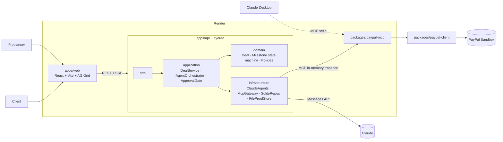

# Arko Pay-on-Proof — Design Document

> **Escrow for freelance work, run by AI agents and backed by PayPal.** The client's money is *held* by PayPal, the work is *checked* by an AI agent, and the money is *released* (or fairly split) only after a person approves.

PayPal AI Hackathon 2026 · Submission deadline **Nov 12, 2026, 12:00 PM PT**

---

## 1. The problem

Each side of a freelance deal carries a risk the other side can't remove:

| Who | Their fear | What happens today |
|---|---|---|
| **Freelancer** | "I'll deliver and never get paid." | Asks for 50% upfront, chases invoices, writes the loss off |
| **Client** | "I'll pay and get bad or missing work." | Refuses upfront payment, or files chargebacks and disputes |
| **Both** | "If we disagree, who decides?" | Weeks of email, platform tickets, or nothing at all |

Marketplace escrow (Upwork-style) only works *inside* that marketplace, takes a large fee, and uses human reviewers. **Most freelance work is agreed directly** over chat or email, and has no protection at all.

**Who it's for:** independent freelancers, small agencies and their clients, including cross-border work where trust is lowest.

## 2. The solution

Arko turns a chat agreement into **PayPal-backed milestones** and puts three AI agents between the two parties:

| Agent | Job | Output |
|---|---|---|
| **Contract Agent** | Reads the pasted chat, email or brief | Milestones with amounts, due dates and **testable acceptance criteria** |
| **Verifier Agent** | Reads the freelancer's proof (images, documents, links, notes) | A verdict for each criterion (met, partly met or not met) with evidence and a confidence score |
| **Mediator Agent** | Hears both sides when they disagree | A fair split (for example 70/30) with reasoning tied to the criteria |
| **Arko (chat)** | An assistant inside the deal room that uses the PayPal MCP tools | Answers "where's my money?" and prepares releases, which wait for approval |

### How money moves (PayPal)

| Step | PayPal API | What it means |
|---|---|---|
| Fund a milestone | `POST /v2/checkout/orders` with `intent: AUTHORIZE`; the payer approves in PayPal | Money is **held** on the client's account and not taken yet |
| Lock the hold | `POST /v2/checkout/orders/{id}/authorize` | Returns an `authorization_id` |
| Release | `POST /v2/payments/authorizations/{id}/capture` | The freelancer is paid |
| Fair split after a dispute | Capture a **partial amount** with `final_capture: true` | The freelancer gets their share and the rest of the hold is released |
| Cancel | `POST /v2/payments/authorizations/{id}/void` | The client keeps the money |
| Refund after release | `POST /v2/payments/captures/{id}/refund` | Full or partial refund |
| Pay the team | `POST /v1/payments/payouts` | Split a released milestone to sub-contractors |
| Receipt | `POST /v2/invoicing/invoices` + `/payments` | An invoice recorded as paid, for the books |

### The story in the demo (3 minutes)

1. A freelancer pastes a WhatsApp-style deal: *"Landing page + logo for ₹… / $900, logo first, 3 rounds of revisions…"*
2. The **Contract Agent** creates 2 milestones with acceptance criteria, and the client accepts the terms.
3. The client clicks **Fund**, the PayPal Sandbox checkout opens, and the client approves. The milestone shows **Funds held by PayPal**.
4. The freelancer uploads proof (logo PNG plus notes). The **Verifier Agent** returns its verdict: 3 of 4 criteria met, with the missing one named.
5. The client taps **Release**. The approval gate shows the policy checks, PayPal captures, and the freelancer is paid. The ledger (AG Grid) updates.
6. Milestone 2 is disputed. The **Mediator** proposes 60/40, both accept, PayPal partially captures, and the rest is released back to the client automatically.
7. In Claude Desktop, *"Arko, what's held in escrow right now?"* runs the same PayPal MCP server.

## 2b. Planning, negotiation and orchestration

| Stage | What happens | Who |
|---|---|---|
| **Ingest** | A SOW or work order in any format (PDF and images read natively by Claude; DOCX, HTML, RTF and EML converted to text) is turned into a faithful transcription for the record | Contract Agent |
| **Draft** | The agreement becomes milestones, each with a specification, deliverables (with formats), a definition of done, amount, due date, dependency and payment terms | Contract Agent |
| **Review** | Checks for definition-of-done items that can't be tested, missing formats, totals that don't match the agreement, dates out of order or missing dependencies | Plan Reviewer (AI) |
| **Negotiate** | Either party edits; each save is a new **version** with a change log; the other party's acceptance is cleared; stale edits are rejected (`409 VERSION_CONFLICT`) | Client ⇄ Freelancer |
| **Agree** | Both accept the **same version**; the plan locks | Both |
| **Execute** | One PayPal hold per milestone; delivery, verification and approval | Humans + agents + PayPal |
| **Change** | Due dates move through **extension requests** (requester ≠ approver, capped by `maxExtensionDays`); a hold that would expire first is **reauthorized** | Both + PayPal |

The **orchestration graph** (`apps/web/src/lib/stategraph.ts`, rendered with React Flow) models each deal as an AWS Step Functions–style state machine: Task, Wait-for-human (task token), Choice, Parallel and Map states, with the execution path highlighted. The **workflow lanes** view draws this as three layers (human decisions, AI agents, PayPal rails), with one lane per milestone. The orchestrator (`apps/web/src/lib/orchestration.ts`) works out each step's state and the **next-step queue** for each party from the same domain rules the API enforces. Scheduling signals (`packages/shared/src/schedule.ts`) are shared, so the API, the UI and the chat agent always agree on what is overdue.

**Access:** HMAC-signed, per-party capability keys (invite links). The acting party always comes from the key on the server, never from the request body.

## 3. How it meets the judging criteria

| Criterion | Evidence |
|---|---|
| **Stage 1: theme and APIs** | PayPal is the core of the product: OAuth2, Orders v2 (AUTHORIZE), Authorizations (capture, partial capture, void, reauthorize), Captures (refund), Payouts and Invoicing |
| **Technical implementation** | Three specialised Claude agents plus a tool-using chat agent, a custom **PayPal MCP server** with tool annotations, an approval gate driven by policies, idempotent PayPal calls, a typed client, SSE streaming and tests |
| **Design** | A complete product: a deal room with a milestone timeline, the verdict and mediation cards, a ledger, an activity trail and the chat; light and dark themes; works on mobile |
| **Potential impact** | Protects both sides of direct freelance deals, which today have no protection |
| **Innovation** | **AI as the neutral third party**: PayPal authorizations turn "trust" into code, and agents decide *whether* the work was done while people decide *whether money moves* |
| **Presentation** | The 7-step demo above runs from end to end in under 3 minutes |
| **Prize targets** | Grand prize, *Best Use of Agentic Commerce*, *Best Use of PayPal + AI*, and sponsor prizes (Render hosting, AG Grid ledger) |

## 4. Architecture



### Packages

```
arko-pay/
├─ apps/api/src/
│  ├─ http/            routes, controllers, error + validation middleware
│  ├─ application/     DealService, AgentOrchestrator, ApprovalGate, ChatAgent
│  ├─ domain/          entities, milestone state machine, policies (pure)
│  ├─ infrastructure/  claude/, mcp/, persistence/ (node:sqlite), storage/
│  └─ config/          env (zod) + composition root (DI container)
├─ apps/web/src/
│  ├─ features/        deals/, milestones/, chat/, ledger/, activity/
│  ├─ components/      UI primitives
│  └─ lib/             api client, SSE client, formatters
├─ packages/shared/        zod schemas + DTOs (shared contract)
├─ packages/paypal-client/ typed PayPal REST (OAuth cache, retries, PayPal-Request-Id)
└─ packages/paypal-mcp/    MCP server (stdio bin + in-process factory)
```

### Milestone state machine

```
draft → awaiting_funding → funding_pending (order created, payer approving)
      → funded (authorization held)
      → submitted (proof uploaded) → verified (AI verdict)
      → released (captured)                      ✓
      → disputed → mediated → settled (partial capture + rest released) ✓
      → cancelled (authorization voided)         ✓
```
Each transition is checked in the domain layer. An invalid transition raises a `DomainError`, which the API returns as `409`.

### Patterns

| Pattern | Where |
|---|---|
| Clean / layered architecture | `apps/api`: http → application → domain, with infrastructure behind ports |
| Ports & adapters | `LlmPort`, `PaymentsPort` (implemented through the MCP gateway), `DealRepository`, `ProofStore` |
| Composition root / DI | `config/container.ts` |
| State machine | `domain/milestone.ts` |
| Strategy (policies) | `ReleasePolicy`, `SplitPolicy`, `AmountLimitPolicy` evaluated by the `ApprovalGate` |
| Command + approval | Money moves the AI proposes become `PendingAction`s that a person approves |
| Repository | SQLite repositories (built-in `node:sqlite`, no native build) |
| Gateway + idempotency | `paypal-client` sends a `PayPal-Request-Id` on every write and retries 429 and 5xx responses |
| Observer (SSE) | Chat agent events stream to the UI |

### MCP tools (PayPal MCP server)

| Tool | Annotation | PayPal endpoint |
|---|---|---|
| `paypal_create_hold` | write | `POST /v2/checkout/orders` (AUTHORIZE) |
| `paypal_authorize_order` | write | `POST /v2/checkout/orders/{id}/authorize` |
| `paypal_get_order` | readOnly | `GET /v2/checkout/orders/{id}` |
| `paypal_get_authorization` | readOnly | `GET /v2/payments/authorizations/{id}` |
| `paypal_capture_authorization` | **destructive** | `POST /v2/payments/authorizations/{id}/capture` |
| `paypal_void_authorization` | **destructive** | `POST /v2/payments/authorizations/{id}/void` |
| `paypal_refund_capture` | **destructive** | `POST /v2/payments/captures/{id}/refund` |
| `paypal_create_payout` | **destructive** | `POST /v1/payments/payouts` |
| `paypal_create_receipt_invoice` | write | `POST /v2/invoicing/invoices` + `/payments` |

## 5. Safety model

- **Agents never move money.** In the chat agent, destructive tools return `approval_required` and create a `PendingAction`. Only a person clicking **Approve** runs them.
- **Policies are checked before every money move:** the amount must be ≤ the authorized amount, the milestone state must allow it, a split must total 100%, and a configurable per-action limit applies.
- **Idempotency:** every PayPal write carries a deterministic `PayPal-Request-Id` (milestone + action), so a retry can't capture twice.
- **Secrets** stay in server-side `.env`. They never reach the browser or the model.
- **Audit trail:** every agent decision, approval and PayPal response ID is logged.

## 6. Engineering standards

TypeScript `strict`; npm workspaces; zod at every boundary; typed errors with one error middleware; vitest unit tests (paypal-client, state machine, policies); ESLint and Prettier; MIT license; a README covering a 5-minute quick start, sandbox test accounts and Claude Desktop MCP setup; `render.yaml` for one-click deploy.

## 7. Sponsor tools

- **Render:** hosted live demo (Blueprint in `render.yaml`).
- **AG Grid:** the escrow ledger, with every milestone and its PayPal order, authorization and capture IDs.

## 8. Out of scope for the deadline

Live PayPal mode, multiple users with authentication (the demo has a role switcher between Client and Freelancer), webhooks (the app polls instead), automatic release timers (shown in the roadmap), and reauthorizing holds older than 3 days.
